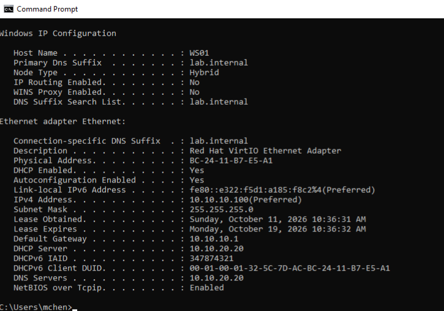
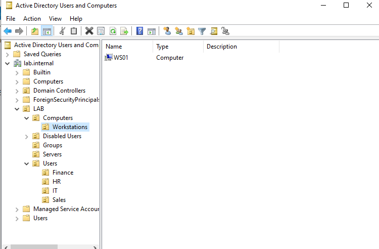
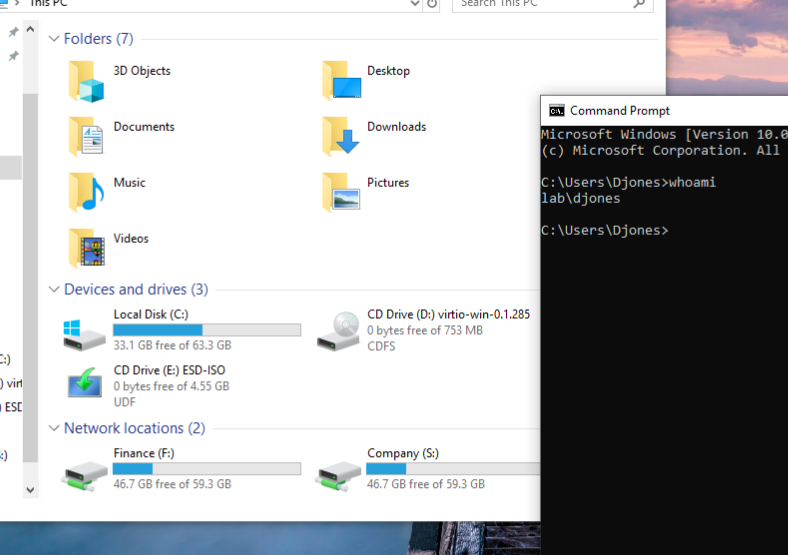
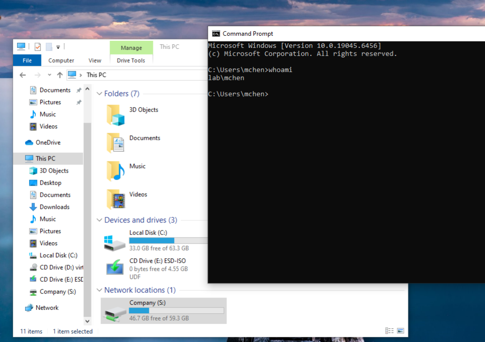
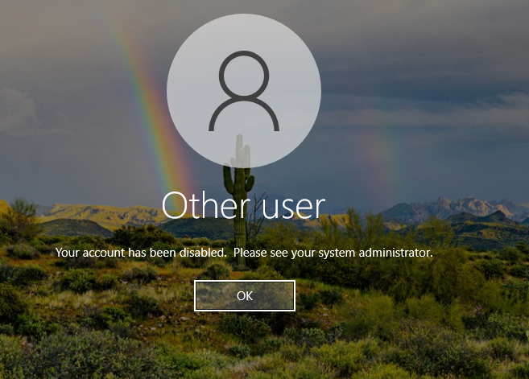
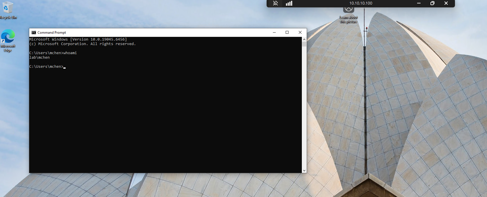

# Active Directory Lab — Rebuild (v2)

## Overview

A from-scratch rebuild of my Windows Server / Active Directory lab, this time running **inside a segmented Cisco network** instead of on my flat home network. The goal is a small-office environment that works the way an IT support technician would actually manage it: a domain controller, centrally managed DHCP and DNS, an OU structure built for Group Policy, department users and groups, password and lockout policy, permission-controlled file shares, drive mappings that follow group membership, desktop restrictions, an offboarding procedure, Remote Desktop access through a group, and printer deployment by Group Policy.

The underlying network (Catalyst 3560G core, two 2960 access switches, two 1941 routers, VLANs, OSPF, NAT, HSRP) is documented in [Cisco network lab repo](https://github.com/Shbucket/homelab-cisco-network-lab-rebuild-). This build depends on it: the domain controller lives in the **Servers VLAN**, workstations live in the **Workstations VLAN**, and DHCP requests cross between them through a relay on the core switch.

As with the network build, every change followed the same method: **predict the result, make the change, verify it, and document what went wrong.**

## Why a rebuild

My first AD lab (domain `corp.local`) was built on the home network. That design had two problems once the network was rebuilt:

- **The domain controller was serving DHCP for my whole house.** Household devices depended on a lab VM being up. The home network now gets DHCP from the home router again, and the DC only serves lab VLANs.
- **Everything was on one flat network.** With the Proxmox host moved onto a VLAN trunk, the old VMs had no network at all. Rather than re-IP a domain controller into a new design, I removed the old domain and built a new forest cleanly.

## Environment

| Component | Details |
|---|---|
| Hypervisor | Proxmox VE on a Dell OptiPlex 7060, single NIC on an 802.1Q trunk with a VLAN-aware bridge |
| Domain controller | **DC01** — Windows Server (evaluation), VLAN 20, **10.10.20.20** |
| Workstation | **WS01** — Windows 10 Pro, VLAN 10, DHCP |
| Domain | **lab.internal** (NetBIOS: **LAB**) |
| VM hardware | q35, OVMF (UEFI), VirtIO SCSI disk and VirtIO NIC, QEMU guest agent |

```
           VLAN 20 (Servers)                      VLAN 10 (Workstations)
        DC01  10.10.20.20                       WS01  10.10.10.100 (DHCP)
  AD DS · DNS · DHCP · NTP client                 domain-joined, Win 10 Pro
               │                                          │
               └──────── Core-Switch (3560G) ─────────────┘
                  SVIs 10.10.20.1 / 10.10.10.1
                  ip helper-address 10.10.20.20 on VLAN 10
                               │
                     Router1 (NAT, NTP source) → Internet
```

---

## 1. Domain controller (DC01)

### VM and OS install

- Created with **VLAN tag 20**, so the DC sits in the Servers VLAN rather than on the home network.
- Windows Server **Desktop Experience** installed onto a VirtIO SCSI disk, loading the `vioscsi` driver from the virtio-win ISO during setup.
- After install, `virtio-win-guest-tools.exe` provided the network driver and QEMU guest agent.

### Static addressing

| Setting | Value |
|---|---|
| IP address | 10.10.20.20/24 |
| Default gateway | 10.10.20.1 (Core-Switch SVI) |
| DNS (before promotion) | 8.8.8.8 |

VLAN 20 deliberately has **no DHCP scope**: servers use static addresses. Connectivity was verified (`ping` gateway, `ping 8.8.8.8`, `nslookup google.com`) and the computer was renamed to **DC01** *before* promotion, since renaming a domain controller afterwards is far more involved.

### Creating the forest

```powershell
Install-WindowsFeature AD-Domain-Services -IncludeManagementTools
Install-ADDSForest -DomainName "lab.internal" -DomainNetbiosName "LAB" -InstallDns
```

- **Domain name `lab.internal`**: `.internal` is reserved for private networks, while `.local` (used in my first lab) conflicts with multicast DNS.
- The **DNS delegation warning** during promotion is expected: there's no parent `.internal` zone to delegate from, and nothing outside the lab needs to resolve this domain.

**Verification after reboot:** `Get-ADDomain`, `nslookup lab.internal`, and `ipconfig /all`.

### DNS

Promotion replaced the DC's DNS server with **`::1` and `127.0.0.1`** — its own loopback addresses. A DC has to query itself, because the domain's **SRV records** (`_ldap`, `_kerberos`) that clients use to find a domain controller only exist in its own DNS. Asking 8.8.8.8 for `lab.internal` would return nothing.

Since DC01 now answers every query itself, internet names needed a **forwarder**:

```powershell
Add-DnsServerForwarder -IPAddress 8.8.8.8
```

IPv6 was left **enabled** on the DC (Microsoft doesn't support disabling it). My first lab's domain-join failure came from my ISP's IPv6 DNS servers overriding the DC; that can't recur here, because VLAN 20 receives no IPv6 router advertisements.

### Time synchronization

The first DC in a forest holds the **PDC Emulator** role and is the time source for every domain member. Kerberos rejects authentication when clocks differ by more than 5 minutes, so it syncs to Router1, which itself syncs to Google's public NTP servers:

```powershell
Set-TimeZone -Id "Eastern Standard Time"
w32tm /config /manualpeerlist:"10.255.0.2,0x8" /syncfromflags:manual /reliable:YES /update
Restart-Service w32time
w32tm /resync
w32tm /query /status
```

Result: **Source 10.255.0.2, Stratum 3.**

```
Google (stratum 1) → Router1 (2) → switches and DC01 (3) → domain members (4)
```

I first predicted stratum 4 ("there's already a stratum 3"). Stratum is simply one more than the source you sync from. DC01 syncs directly from Router1, so it's a **peer** of the switches at stratum 3, not below them.

---

## 2. DHCP on the domain controller

VLAN 10's DHCP was previously served by Router2 (IOS) and handed out 8.8.8.8 for DNS. Domain clients must use the DC for DNS, and Windows DHCP is what a support team manages day to day, so VLAN 10 moved to DC01.

### Role, authorization, and scope (GUI)

1. **Add Roles and Features → DHCP Server.**
2. **Complete DHCP configuration** — creates the *DHCP Administrators* / *DHCP Users* groups and **authorizes** the server in AD. An unauthorized Windows DHCP server in a domain won't hand out leases — AD's built-in protection against rogue DHCP servers.
3. **New Scope:**

| Setting | Value |
|---|---|
| Name | VLAN10-Workstations |
| Range | 10.10.10.100 – 10.10.10.254 /24 |
| Lease | 8 days (Windows default) |
| 003 Router | 10.10.10.1 |
| 006 DNS Servers | 10.10.20.20 |
| 015 DNS Domain Name | lab.internal |

### Network side

```
! Core-Switch — point the relay at DC01
interface vlan 10
 no ip helper-address 10.255.0.3
 ip helper-address 10.10.20.20

! Router2 — remove the old pool so VLAN 10 has exactly one DHCP server
no ip dhcp pool VLAN10
no ip dhcp excluded-address 10.10.10.1 10.10.10.99
```

**How a server in VLAN 20 serves VLAN 10:** the Core-Switch's relay fills in the **giaddr** field with the address of the interface that heard the broadcast (10.10.10.1). DC01 matches giaddr to the scope whose range contains it. One DHCP server can serve any number of VLANs this way.

**The guest VLAN (50) deliberately stays on Router2.** Guests shouldn't use the corporate DNS server or be able to see `lab.internal`.

---

## 3. Workstation (WS01)

### Build

- Windows 10 **Pro** — Home edition can't join a domain, a classic "why won't this laptop join?" ticket.
- **VLAN tag 10**, VirtIO disk and NIC.
- With no network driver during setup, Windows was set up with **"I don't have internet" → limited setup** and a local account (`localadmin`), kept as a break-glass account for when domain logins fail.

### DHCP verified from both sides

```
IPv4 Address . . . . . : 10.10.10.100
Default Gateway  . . . : 10.10.10.1
DHCP Server  . . . . . : 10.10.20.20
DNS Servers  . . . . . : 10.10.20.20
DNS Suffix . . . . . . : lab.internal
Lease Obtained / Expires : Oct 10 → Oct 18 (8 days)
```


**DHCP Server shows DC01, not the relay.** The switch forwards the request and returns the reply, but never presents itself as the server, so `ipconfig /all` always points at the server to troubleshoot, even across VLANs. The lease also appeared in the DHCP console under the scope's **Address Leases**.

### Domain join

Before joining, I checked the lookup that the join itself depends on:

```
nslookup -type=SRV _ldap._tcp.dc._msdcs.lab.internal
```

Then renamed to **WS01** and joined `lab.internal` in the same `sysdm.cpl` dialog, saving a restart. A Proxmox snapshot (`pre-domain-join`) was taken first, so the join can be repeated or broken on purpose later.

---

## 4. OU structure

The new WS01 computer object landed in the default **Computers** container. That's a **container, not an OU**: Group Policy can't be linked to it. Even its right-click menu shows the difference — there's no *New → Organizational Unit* option inside a container.

```
lab.internal
├── Domain Controllers          (DC01 stays here)
└── LAB
    ├── Users
    │   ├── IT
    │   ├── HR
    │   ├── Finance
    │   └── Sales
    ├── Computers
    │   └── Workstations        (WS01)
    ├── Servers
    ├── Groups
    └── Disabled Users
```



- **One top-level LAB OU** separates everything I created from the built-in containers.
- **Users and computers are split**, since user and computer policies are usually linked to different OUs.
- **Department OUs** allow department-specific policy.
- **Disabled Users** supports a standard offboarding process: disable and move rather than delete.
- **DC01 stays in Domain Controllers**, because the *Default Domain Controllers Policy* linked there carries settings every DC needs.

New computers are redirected into Workstations automatically, so they receive the right policies from their first boot:

```
redircmp "OU=Workstations,OU=Computers,OU=LAB,DC=lab,DC=internal"
```

---

## 5. Users and groups

### Separate admin account

The built-in Administrator isn't used day to day. My admin account (`adm.<name>`) is a member of **Domain Admins** and is used only for administrative work — the same two-account model many companies use for IT staff, which limits the damage if an everyday account is compromised.

### Department users and groups

| Department OU | Test user | Group (Global, Security) |
|---|---|---|
| IT | jreyes | IT-Staff |
| HR | mchen | HR-Staff |
| Finance | djones | Finance-Staff |
| Sales | abrooks | Sales-Staff |

New accounts were created with **"User must change password at next logon."** When mchen first signed in on WS01, Windows forced her to replace the temporary password. That's the point of the setting: afterwards **IT doesn't know the user's password**, so activity under her account is genuinely hers. Every helpdesk password reset uses the same checkbox.

---

## 6. Password and lockout policy

Configured in the **Default Domain Policy** → Computer Configuration → Policies → Windows Settings → Security Settings → Account Policies:

| Setting | Value |
|---|---|
| Minimum password length | 12 |
| Complexity requirements | Enabled |
| Password history | 10 |
| Account lockout threshold | 5 invalid attempts |
| Lockout duration | 15 minutes |
| Reset lockout counter after | 15 minutes |

**Why the domain root and not an OU?** For domain accounts, password and lockout settings only take effect from a GPO linked at the domain level. The same settings linked to an OU only affect *local* accounts on computers in that OU. (Fine-grained password policies are the exception, for giving one group different rules.)

Verified on WS01 with `gpupdate /force` and `net accounts /domain`.

### Lockout ticket simulation

*"Jordan Reyes says he can't log in."*

1. Five wrong passwords for `jreyes` on WS01 → **"The referenced account is currently locked out and may not be logged on to."**
2. Unlocked in ADUC: **Find → jreyes → Account tab → Unlock account**, then confirmed the correct password worked.
3. Without intervention, the account unlocks itself after the 15-minute lockout duration — slow enough to make password guessing useless (5 guesses per 15 minutes), while a user who mistyped can simply wait.
4. **Finding the source of a lockout:** on the DC, Security log **Event ID 4740** records the locked account and the **Caller Computer Name**. In production, that's how you track down the old phone or saved credential that keeps locking someone out.

---

## 7. File shares and permissions

One share at the top, with NTFS permissions controlling each department folder:

| Path | Share permission | NTFS permission |
|---|---|---|
| `C:\Shares` → `\\dc01\Shares` | Authenticated Users: Full Control (Everyone removed) | — |
| `C:\Shares\Company` | (inherited share) | Domain Users: Modify |
| `C:\Shares\Finance` | (inherited share) | Inheritance disabled; *Users* removed; **Finance-Staff: Modify**; Administrators and SYSTEM: Full Control |

**Share permissions are left open and NTFS does the real access control.** When both apply, the most restrictive wins, so keeping every rule in one place avoids the "I granted access but it still says denied" ticket.

### Results

| User | `\\dc01\Shares\Company` | `\\dc01\Shares\Finance` |
|---|---|---|
| djones (Finance) | Opens | Opens |
| mchen (HR) | Opens | **Access denied** |

**Access-based enumeration** was then enabled on the share (Server Manager → File and Storage Services → Shares → Properties → Settings), so users don't even see folders they can't open.

In production these shares belong on a dedicated file server rather than a domain controller. Hosting them on DC01 is a lab simplification.

---

## 8. Drive mappings with Group Policy Preferences

A **Drive Mappings** GPO linked to **LAB → Users** (User Configuration → Preferences → Windows Settings → Drive Maps):

| Drive | Path | Applies to |
|---|---|---|
| **S:** Company | `\\dc01\Shares\Company` | All users in LAB\Users |
| **F:** Finance | `\\dc01\Shares\Finance` | Only members of **Finance-Staff** (item-level targeting) |

| User | S: | F: |
|---|---|---|
| djones (Finance) | ✅ | ✅ |
| mchen (HR) | ✅ | — |


 

Left: `lab\djones` (Finance) gets F: and S:. Right: `lab\mchen` (HR) gets only S:.

**User policies follow the user, not the computer.** WS01 sits in Computers\Workstations, but the mappings come from the user's OU, so they apply wherever the user signs in. Verified with `gpresult /r` under *USER SETTINGS → Applied Group Policy Objects*.

---

## 9. Desktop restrictions with security filtering

A **Desktop Restrictions** GPO linked to **LAB → Users**:

User Configuration → Policies → Administrative Templates → Control Panel → **Prohibit access to Control Panel and PC settings: Enabled**

The IT OU sits under LAB\Users too, so by default IT staff — including my admin account — would be locked out of Control Panel as well. **Security filtering** limits who the policy applies to:

| Tab | Change |
|---|---|
| Scope → Security Filtering | Removed **Authenticated Users**; added **HR-Staff**, **Finance-Staff**, **Sales-Staff** |
| Delegation | Added **Authenticated Users** back with **Read** only (not Apply) |

**The Delegation step is the gotcha.** Since the MS16-072 security update, computers read user GPOs using the **computer's own account**. Removing Authenticated Users entirely means computers can't read the GPO, and it silently applies to **nobody**. Read (without Apply) lets the computer read it while the filter still decides who it applies to.

| User | Control Panel / Settings |
|---|---|
| mchen (HR) | Blocked |
| IT user | Opens normally |

---

## 10. Offboarding procedure

*Ticket: "Ashley Brooks (Sales) left the company effective today. Please remove her access."*

| Step | Action in ADUC | Why |
|---|---|---|
| 1 | **Disable** the account | Blocks new sign-ins while keeping the account and its history |
| 2 | **Reset the password** to a random value | If it's re-enabled by mistake, nobody knows the password |
| 3 | Record, then **remove group memberships** (except Domain Users, the primary group) | Removes access; the record allows a rehire to be restored |
| 4 | Set **Description**: `Disabled 2026-10-14 - offboarded, ticket #001` | Anyone who finds the account later knows why |
| 5 | **Move** to **LAB → Disabled Users** | Separates inactive accounts from active ones |

Signing in as `abrooks` on WS01 then returned **"Your account has been disabled."**




**Why disable instead of delete:** every account has a unique security identifier (SID). A deleted account can't be restored by recreating the username — the new account gets a new SID and none of the old permissions or file ownership. Disabling first, and deleting only after a retention period, keeps data handover possible.

**Disabling doesn't end an active session.** A user already signed in keeps working, and their Kerberos tickets stay valid for up to 10 hours. Real terminations also sign the user out or lock the device — and in Microsoft 365, revoke their sessions.

---

## 11. Remote Desktop through a group

*Ticket: "Maria Chen (HR) needs to remote into WS01."* Rather than making her a local administrator, RDP access comes from group membership, deployed to every workstation by GPO.

- Group **RDP-Users** (Global, Security) in LAB\Groups, containing mchen.
- GPO **Workstation RDP** linked to **LAB → Computers → Workstations** (Computer Configuration):

| Setting | Value |
|---|---|
| Remote Desktop Session Host → Connections → **Allow users to connect remotely by using Remote Desktop Services** | Enabled |
| Network → Network Connections → Windows Defender Firewall → Domain Profile → **Allow inbound Remote Desktop exceptions** | Enabled, scoped to `10.0.0.0/24,10.10.0.0/16` |
| Preferences → Local Users and Groups → **Remote Desktop Users (built-in)** | Update: add `LAB\RDP-Users` |

The third setting adds the domain group to each workstation's **local** Remote Desktop Users group, so access is managed in one place — RDP-Users membership — with no local admin rights involved.

**Result:** mchen connected to WS01 over RDP from my PC on the home network (`mstsc` → 10.10.10.100), routed through the lab.


---

## 12. Printer deployment

DC01 runs the **Print Server** role with a shared queue, **HR-Printer** (Generic / Text Only driver on the NUL port, standing in for a physical printer).

A **Printer Deployment** GPO linked to **LAB → Users** (User Configuration → Preferences → Control Panel Settings → Printers) adds `\\dc01\HR-Printer` as a shared printer, with **item-level targeting** to **HR-Staff** — the same pattern as the Finance drive.

| User | HR-Printer |
|---|---|
| mchen (HR) | Installed automatically, no driver prompt |
| Finance user | Not deployed |

Because the Generic / Text Only driver is built into Windows, the connection didn't hit the **post-PrintNightmare restriction** that blocks standard users from installing printer drivers from a print server — one of the most common printer tickets in practice.

Desktop Restrictions also blocks the Settings app for HR, so mchen couldn't open *Printers & scanners*. That's realistic: environments that lock down Settings are exactly the ones that push printers through Group Policy. The printer was verified from the Notepad print dialog and with `Get-Printer` instead.

**Open issue:** test jobs printed **on DC01** reached the queue and were logged (PrintService Operational log, Event ID 307), but jobs sent by mchen from WS01 — via `Out-Printer` with no error, to the correct `\\dc01\HR-Printer` name — never appeared on the server, with the printer paused or resumed. Unresolved; the deployment itself works as designed.

---

## Design decisions

| Decision | Reason |
|---|---|
| DC in its own VLAN, static IP | Servers don't depend on DHCP; the Servers VLAN has no scope at all |
| `lab.internal` instead of `.local` | `.internal` is reserved for private use; `.local` conflicts with mDNS |
| DC uses only itself for DNS, forwarder to 8.8.8.8 | AD's SRV records only exist in the DC's DNS |
| DC syncs time from Router1 | One time source for network gear and the domain; Kerberos needs clocks within 5 minutes |
| Windows DHCP for VLAN 10, IOS DHCP kept for guests | Domain clients need the DC's DNS; guests shouldn't see the domain |
| Home network DHCP returned to the home router | The household no longer depends on a lab VM |
| Separate admin account | Everyday accounts never hold Domain Admin rights |
| Share permissions open, NTFS controls access | One place to manage and troubleshoot access |

---

## Lessons Learned / Troubleshooting

**Missed the "Press any key to boot from CD" prompt.** The UEFI boot prompt lasts about 5 seconds; with no key press, the VM fell through to **PXE over IPv4**. Keypresses only reach the VM once the Proxmox console has focus, so the fix was to reset the VM, click into the console immediately, and keep pressing a key.

**No network on the new server.** Two causes, both expected: Windows has no VirtIO network driver until the guest tools are installed, and VLAN 20 intentionally has no DHCP, so the server gave itself a 169.254.x.x address until the static IP was set.

**DC01 claimed to be stratum 1 from its own hardware clock.** After the first NTP configuration, `w32tm /query /status` showed:

```
Stratum: 1 (primary reference - syncd by radio clock)
ReferenceId: 0x4C4F434C (source name: "LOCL")
Source: Local CMOS Clock
Last Successful Sync Time: 10/10/2026 12:12:47 PM
```

Three things were wrong:

- **It hadn't synced at all.** With `/reliable:YES` and no reachable source, Windows falls back to its own CMOS clock and advertises it as authoritative — dangerous, because clients would trust whatever time it served.
- **The time zone was Pacific**, the default on a fresh Windows Server install, visible because the last sync time was exactly 3 hours behind local time.
- **The peer was missing the `,0x8` flag.** Without it, Windows uses symmetric-active mode, which Cisco IOS doesn't always answer. `0x8` forces client mode.

After `Set-TimeZone` and reconfiguring with `10.255.0.2,0x8`, the DC reported **Source 10.255.0.2, Stratum 3**.

**DHCP authorization "failed" with error 20079.** The post-install wizard reported *"The specified servers are already present in the directory service."* Error 20079 actually means the server was **already authorized** — an earlier step had done it. The wizard's "failure" left Server Manager's warning flag in place, which can be cleared with:

```powershell
Set-ItemProperty -Path HKLM:\SOFTWARE\Microsoft\ServerManager\Roles\12 -Name ConfigurationState -Value 2
```

**DHCP console menus greyed out.** Right-clicking the server in the middle pane showed every option disabled, including Start/Stop. The console hadn't connected to the service yet; expanding the server in the left pane (and restarting the DHCP Server service) loaded it, showing IPv4/IPv6 with a green check.

**"New → Organizational Unit" missing.** Right-clicking the **Computers** container offered no OU option — a container can't hold OUs. OUs are created on the domain itself or inside another OU, and they show a different icon in ADUC.

**Permissions almost set on the parent folder.** NTFS permissions were briefly being added to `C:\Shares` instead of `C:\Shares\Company`. Granting Domain Users Modify on the parent would have flowed down to Finance, and **disabling inheritance with "convert to explicit permissions"** would then have copied that entry into Finance — giving the whole company access to it. Permissions belong on the specific folder.

**Finance folder "access denied" for everyone.** The test was using `\\dc01\Finance`, but the share was created on the parent folder as **Shares**, so the correct path is `\\dc01\Shares\Finance`. A wrong UNC path is one of the most common "I can't open the folder" tickets.

**S: drive missing for every user.** The Finance user's F: mapping worked, which proved the GPO itself was applying, so the problem had to be the S: item. Its path was typed as **`\\dco1\...` — the letter O instead of a zero.** A bad path makes a drive mapping fail silently for the user; the reason is logged on the client under Event Viewer → Application, source *Group Policy Drive Maps*. Using the browse button or pasting a path copied from File Explorer avoids it.

**RDP refused after the GPO applied.** `gpresult /r` listed Workstation RDP, but `netstat -an | findstr 3389` returned nothing — WS01 wasn't listening at all. The Remote Desktop setting didn't take effect from `gpupdate /force` alone; **restarting WS01** brought port 3389 up and the connection worked. If a policy shows as applied but its effect isn't there, a restart is the next step before digging deeper.

**Desktop restrictions vs. printer checks.** Testing the printer as mchen, the Settings app wouldn't open — blocked by the Desktop Restrictions GPO from step 9, working as intended. Policies interact: a lockdown applied for one reason affects troubleshooting for another. Verified through the Notepad print dialog and `Get-Printer` instead.

**Print jobs from WS01 never reached the server (open).** Jobs from DC01 itself printed and logged Event 307; jobs from mchen on WS01 produced no error and never appeared in the server queue. Checked: correct printer name, spooling settings, paused/resumed queue. Still open — the next checks would be the PrintService Operational log on WS01 and the Print Spooler firewall rules on DC01.

**WS01 clock on Pacific time.** The VM image defaulted to Pacific; fixed with `tzutil /s "Eastern Standard Time"`. Domain time sync corrects the clock, not the time zone. The fleet-wide fix is a GPO or the image itself.

---

## What's Next

- **DHCP redundancy** — Windows DHCP failover, or a split scope for the guest VLAN on IOS (HSRP provides gateway redundancy, not DHCP redundancy)
- **Microsoft 365 / Entra ID and Intune**, aligned with MD-102
